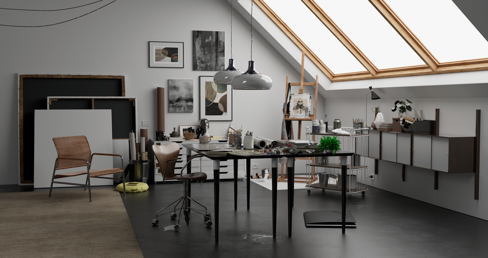

# Foundation

*Image: [WaterColor V1 scene](https://github.com/mos9527/Foundation-Resources/tree/master/watercolor) rendered with the Progressive Path Tracer `PT`, 4096 spp, Fast preset*

Please check out the [Documentation](https://mos9527.com/Foundation/) for more info. 

## Blog Posts 
- https://mos9527.com/posts/foundation/pt-1-mesh-shader-continous-lod/
- https://mos9527.com/posts/foundation/pt-2-gpu-driven-pipeline-with-culling/
- https://mos9527.com/posts/foundation/pt-3-profiler-and-wave-intrinsics/
- https://mos9527.com/posts/foundation/pt-4-mesh-quantization/
- https://mos9527.com/posts/foundation/pt-5-texture-compression-and-gbuffer/
- https://mos9527.com/posts/foundation/pt-6-path-tracing-adventures/

## Labs

### Denoisers, Reconstruction and Spatio-Temporal Reuse
#### Denoising 
- Basic temporal accumulation super-sampling [Rasterizer]
- Basic A-trous spatial filter w/ guidance [Realtime Pathtracer]
- Temporal reuse in [Realtime Pathtracer]
##### Links
- [VARIABLE RATE RAY TRACING IN CALL OF DUTY: MODERN WARFARE 4](https://advances.realtimerendering.com/s2026/index.html#:~:text=Rate%20Ray%20Tracing%20(-,VRRT,-)%20system%20designed%20to)
#### Sampling
- TODO ReSTIR
